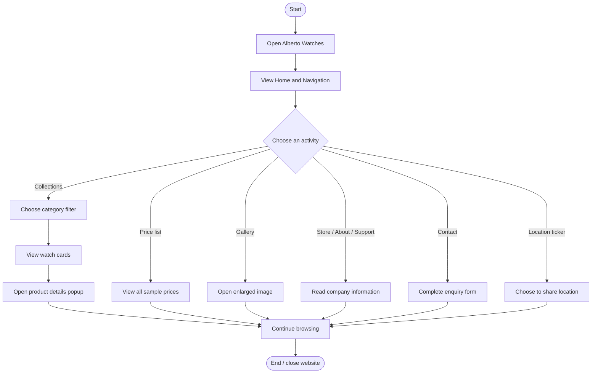

# Alberto Watch Company — eProject Report

## 1. Project team
- Arham Gohar
- Sheryar
- Huzaifa Rehman

## 2. Problem definition
Alberto Watch Company is a full-service watch retail, repair and appraisal business. The project brief requests a responsive single-page website that presents watch collections, technology information, a price list, gallery, store information, support, company information and contact details.

## 3. Objectives
- Present the company and its watch collections in a polished, responsive interface.
- Let visitors filter watches by Luxury, Vintage, Smart and Classic categories.
- Show product details in a popup window.
- Provide a consolidated price list and image gallery.
- Display a visitor counter and a continuously scrolling ticker with date, time and optional geolocation.
- Provide store, support, about and contact information.

## 4. Design specifications
The website uses a dark forest-green and warm gold palette, editorial serif headings, responsive Bootstrap layout, image-led product cards and subtle hover/entrance animations. The layout is a single-page application-style experience with anchor navigation.

## 5. Technology stack
- HTML5 for semantic page structure.
- CSS3 for layout, responsive breakpoints, transitions and animation.
- Bootstrap 5.3 for responsive grid, navigation and modals.
- JavaScript and jQuery for filtering, product rendering, navigation state, ticker, form handling and gallery interactions.
- JavaScript product data (`assets/js/products.js`) as the JSON-style data store.
- LocalStorage for a browser-local demonstration visitor count.
- HTML5 Geolocation API, invoked only after the visitor clicks the location label and grants permission.

## 6. Main modules
1. Header/navigation and visitor count.
2. Hero and company introduction.
3. Product collection filters and product-detail modal.
4. Technology information.
5. Price list.
6. Gallery with enlarged-image modal.
7. Store locator information.
8. About, team and support sections.
9. Contact enquiry form demonstration.
10. Scrolling date/time/location ticker and footer sitemap.

## 7. Activity flow

## 8. Data flow overview
- Product catalogue: `products.js` → `script.js` → collection cards and price table.
- Filter selection: visitor click → selected category → filtered product cards.
- Product detail: visitor selects card → product ID lookup → Bootstrap modal.
- Visitor count: page load → read LocalStorage value → increment → save → display.
- Geolocation: visitor clicks location label → browser permission prompt → coordinates or unavailable message.
- Contact form: visitor submits valid fields → front-end confirmation message. No server transmission occurs.

## 9. Test data and test cases
| ID | Test | Expected result |
|---|---|---|
| T01 | Open `index.html` in a modern browser | Homepage and navigation load |
| T02 | Select Luxury filter | Only Luxury products are shown |
| T03 | Select All watches | All six sample products return |
| T04 | Open a product card | Correct product details appear in modal |
| T05 | View price list | All six products and sample prices appear |
| T06 | Click a gallery tile | Enlarged image modal opens |
| T07 | Submit empty contact form | Browser required-field validation appears |
| T08 | Submit valid contact form | Demo confirmation appears and fields reset |
| T09 | Reload page in same browser | Local visitor counter increments |
| T10 | Click ticker location label | Browser requests location permission |
| T11 | Resize viewport to mobile width | Navigation and content adapt to narrow screen |
| T12 | Click a navigation item on mobile | Section opens and collapsed menu closes |

## 10. Installation instructions
1. Extract `Alberto_Watches_Team_Project.zip`.
2. Open the extracted `alberto-watches` folder.
3. Open `index.html` in Chrome, Edge, Firefox or Safari.
4. Internet access is recommended for Bootstrap, jQuery, Google Fonts and remote image URLs.
5. For geolocation, use localhost or HTTPS and grant permission when prompted.

## 11. Assumptions and limitations
- The brief names Alberto Watch Company but does not provide verified contact or store details. The displayed showroom address, email and phone are placeholders and must be replaced with verified details.
- Watch names, images, references and prices are sample demonstration data, not confirmed company inventory or quotations.
- The visitor counter is stored in the current browser's LocalStorage; it is not a shared analytics counter.
- The contact form is a front-end demonstration only. A backend/API and appropriate privacy/security handling are required to receive enquiries.
- Location is requested only after a visitor action. If permission is denied or unavailable, the ticker displays an explanatory status.
- Product photography is loaded from remote image URLs and requires internet access.

## 12. Team contribution record
The following names are recorded as the project group. Individual task allocations can be completed by the group before submission:
- Arham Gohar
- Sheryar
- Huzaifa Rehman

## 13. Conclusion
The project delivers a responsive single-page watch company website covering the core functional requirements in the supplied Alberto Watch Company specification. The code is separated into HTML, CSS and JavaScript files to support review and future development.
